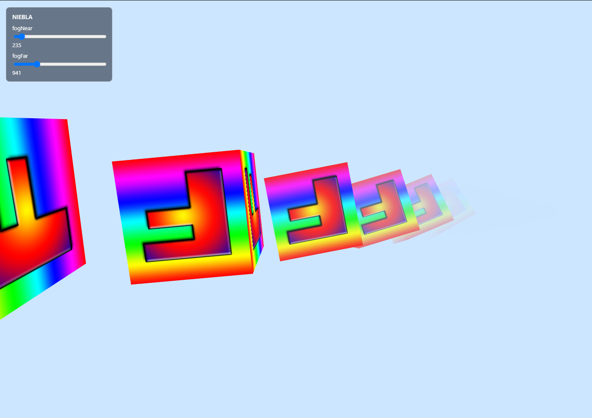

# Fog Shader — Visual Computing 2026-II

Escena WebGL interactiva construida con [p5.js](src/libraries/p5.min.js) que implementa un **shader de niebla basado en profundidad** sobre una hilera de 41 cubos texturizados en rotación.

 

| |
|---|
|  |

**Jugar en línea:** [https://shryhakakizuki.github.io/Fog_shader-Visual_Computing_2026-II/](https://shryhakakizuki.github.io/Fog_shader-Visual_Computing_2026-II/)


## Integrantes

| Integrante | GitHub |
|---|---|
| Oscar Leonardo Riveros Perez | [ShryhakAkizuki](https://github.com/ShryhakAkizuki) |
| Camilo Ferney Londoño Moreno | [CamiloLM](https://github.com/CamiloLM) |
| Omar Nicolas Guerrero Guerrero | [camisabo](https://github.com/camisabo) |
| Oscar Ivan Ulises Gutiérrez Palacios | [10scar](https://github.com/10scar) |


## Estructura del proyecto

```
├── README.md
├── LICENSE                          # GNU AGPL v3
├── .github/
│   └── workflows/
│       └── deploy-pages.yml         # CI/CD: despliegue a GitHub Pages
├── docs/                            # Documentación técnica
│   ├── README.md                    # Índice de la documentación
│   ├── instalacion.md               # Requisitos y ejecución
│   ├── estructura.md                # Estructura y flujo de datos
│   ├── tecnica-shader-niebla.md     # Teoría e implementación del shader
│   ├── referencia-configuracion.md  # Referencia de parámetros
└── src/
    ├── index.html                   # Punto de entrada (estilos + carga de scripts)
    ├── main.js                      # setup()/draw(): cámara, animación, cubos
    ├── shaders.js                   # Código GLSL (fogVert/fogFrag) + initFog()/applyFog()
    ├── config.js                    # Todos los parámetros de la escena
    ├── ui.js                        # Panel de control (sliders de niebla)
    ├── assets/f-texture.png         # Textura de los cubos
    └── libraries/p5.min.js          # p5.js local
```

## Ejecución

No hay instalación ni compilación. Solo se necesita un navegador con soporte WebGL.

```bash
python -m http.server 8080 -d src
```

Luego abrir <http://localhost:8080>.

> **Nota**: no abrir `src/index.html` directamente con `file://`: la textura se carga vía XHR y el navegador puede bloquearla por CORS.
> Alternativas: `npx serve src` o la extensión *Live Server* de VS Code.

## Despliegue en GitHub Pages

El despliegue lo hace un workflow de GitHub Actions ([deploy-pages.yml](.github/workflows/deploy-pages.yml)): al hacer `push` a la rama `main`, se publica el contenido de la carpeta `src/` en

```
https://shryhakakizuki.github.io/Fog_shader-Visual_Computing_2026-II/
```

## Cómo funciona

1. **Vertex shader** ([shaders.js:11](src/shaders.js#L11)): transforma cada vértice a espacio de vista y exporta su profundidad `vFogDepth = -viewPos.z`, interpolada por el rasterizador.
2. **Fragment shader** ([shaders.js:30](src/shaders.js#L30)): muestrea la textura del cubo y calcula
   ```glsl
   float fogAmount = smoothstep(uFogNear, uFogFar, vFogDepth);
   gl_FragColor    = mix(color, uFogColor, fogAmount);
   ```
   Es decir: `0` de niebla por debajo de `fogNear`, `1` por encima de `fogFar`, y un degradado suave en medio.
3. **Animación** ([main.js:17](src/main.js#L17)): cada fotograma se reubica la cámara, se acumulan los ángulos de rotación y se dibuja la hilera de cubos con el shader activo.
4. **UI** ([ui.js:4](src/ui.js#L4)): el panel de `#fog-panel` crea sliders que escriben en `settings`; [`applyFog()`](src/shaders.js#L42) lee esos valores cada fotograma.

El color de fondo de la escena es idéntico a `FOG_COLOR` ([config.js:1](src/config.js#L1)), por lo que los cubos lejanos se disuelven de forma continua en el fondo.

## Parámetros principales

Todos los valores ajustables viven en [config.js](src/config.js):

| Parámetro | Valor | Descripción |
|-----------|-------|-------------|
| `FOG_COLOR` | `[0.8, 0.9, 1.0, 1.0]` | Color de la niebla y del fondo |
| `settings.fogNear` | `10` | Inicio de la niebla (slider) |
| `settings.fogFar` | `500` | Saturación total de la niebla (slider) |
| `NUM_CUBES` | `40` | Cubos dibujados: `NUM_CUBES + 1` |
| `CUBE_SIZE` | `100` | Unidad base de la escena |
| `ROT_X_SPEED` / `ROT_Y_SPEED` | `-0.4` / `-0.7` | Velocidades de rotación (rad/s) |
| `FOV_DEG` | `60` | Campo de visión vertical |

La referencia completa (cámara, espaciado de cubos, límites de sliders, guía de ajuste) está en [docs/referencia-configuracion.md](docs/referencia-configuracion.md).

## Documentación

La documentación técnica completa está en [`docs/`](docs/README.md):

- [Instalación y resolución de problemas](docs/instalacion.md)
- [Estructura del proyecto y flujo de datos](docs/estructura.md)
- [Técnica del shader de niebla (GLSL)](docs/tecnica-shader-niebla.md)
- [Referencia de configuración](docs/referencia-configuracion.md)

## Licencia

Distribuido bajo la licencia **GNU AGPL v3** — ver [LICENSE](LICENSE).
